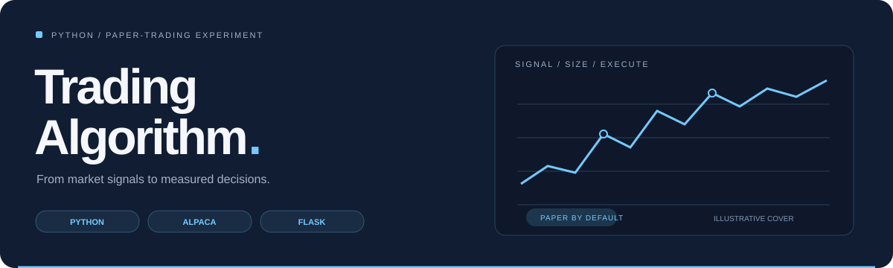
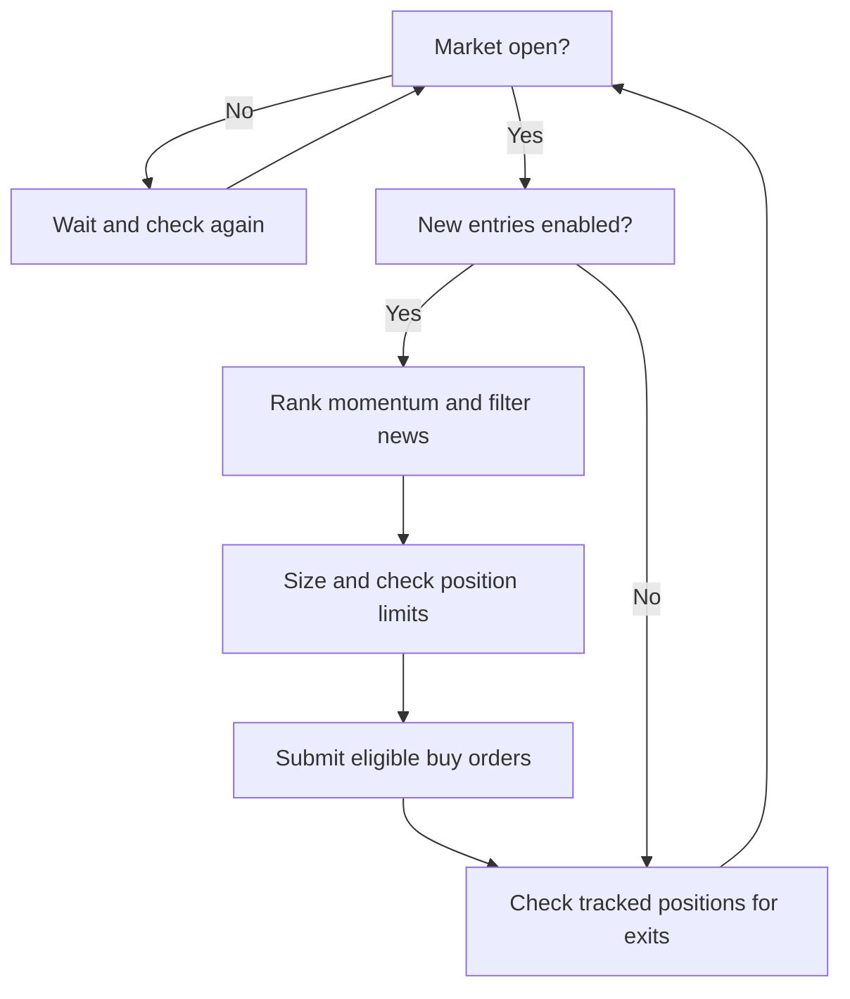

<div align="center">

**A Python experiment in momentum, position sizing, and automated exits.**

[Strategy](strategy/) · [Configuration](config.py) · [Discord controls](#04--observe-and-control) · [Setup](#02--set-up-a-paper-session)

</div>

---

## 01 / The system

Trading Algorithm evaluates short-term stock momentum, filters candidates using recent-news sentiment, sizes positions, and submits orders through Alpaca. Discord provides notifications, status, and permission-gated trading controls.

**Paper trading is the default.** This README describes the code and configuration, not demonstrated investment returns.

<table>
<tr>
<td width="50%" valign="top">

### Find an entry
Rank positive price changes over a five-minute window, then filter candidates through recent-news sentiment.

[Momentum strategy →](strategy/momentum_strategy.py)

</td>
<td width="50%" valign="top">

### Bound the position
Calculate a share quantity using buying power, stop distance, volatility, sentiment, and configured position caps.

[Position sizing →](strategy/position_sizing.py)

</td>
</tr>
</table>



Pausing new entries still allows the loop to check existing tracked positions for sells while the market is open.

## 02 / Set up a paper session

Use **Python 3.12** and credentials for an **Alpaca paper-trading account**.

```bash
git clone https://github.com/KaiAlexander-commits/Trading-Algorithm.git
cd Trading-Algorithm
python -m venv .venv
```

Activate the environment and install dependencies:

```bash
# macOS / Linux
source .venv/bin/activate

# Windows PowerShell
.venv\Scripts\Activate.ps1

python -m pip install -r requirements.txt
```

Use [.env.example](.env.example) as the variable reference. **The application does not load `.env` files automatically.** Set variables in your shell or deployment environment.

| Variable | Purpose |
| --- | --- |
| `ALPACA_API_KEY` | Required API key |
| `ALPACA_SECRET_KEY` | Required API secret |
| `ALPACA_BASE_URL` | Defaults to `https://paper-api.alpaca.markets` |
| `DISCORD_BOT_TOKEN` / `DISCORD_CHANNEL_ID` | Optional Discord bot connection and controls |
| `WEBHOOK_URL` | Optional Discord webhook fallback |

Run the trading loop and Discord bot:

```bash
python main.py
```

The process can submit orders to the configured Alpaca account. Keep paper credentials and the paper endpoint for experimentation.

## 03 / The defaults

These values come from [config.py](config.py); they are parameters, not guarantees about fills or losses.

| Setting | Default |
| --- | --- |
| Entry-cycle interval | 120 seconds |
| Maximum candidates bought per round | 6 |
| Dollar cap per new trade | $20 |
| Profit target / stop-loss threshold | 3% / 3% |
| Trailing-stop threshold | 2% |
| Sizing risk parameter | 2% |
| Position cap parameter | 10% |
| News sentiment filter | −0.3 |
| Emergency news threshold | −0.5 |

Positions tracked by the strategy live in memory. The strategy does not rebuild that tracking dictionary from broker positions on startup. Its broker adapter treats a successful order submission as success; it does not wait for a confirmed fill.

## 04 / Observe and control

When the Discord bot is configured, it provides these slash commands:

| Command | Purpose | Permission |
| --- | --- | --- |
| `/status` | Show trading and market status | Any server member |
| `/start` | Enable new entries | Manage Server |
| `/stop` | Stop new entries while retaining sell checks | Manage Server |
| `/clear` | Delete recent channel messages | Manage Messages |

## 05 / Find your way around

| Path | Responsibility |
| --- | --- |
| [main.py](main.py) | Process startup, market clock, and entry/exit loop |
| [trading_state.py](trading_state.py) | Shared entry-control state |
| [broker/](broker/) | Alpaca data and order adapter |
| [strategy/](strategy/) | Ranking, position sizing, and exit rules |
| [data/news_filter.py](data/news_filter.py) | News sentiment filtering |
| [messaging/](messaging/) | Discord bot and notifications |
| [logger.py](logger.py) | Trade and system-event logging |
| [tests/](tests/) | State, news, sizing, and exit-rule tests |

## 06 / Development

```bash
python -m unittest discover -s tests -v
python -m compileall -q .
docker build -t trading-algorithm .
```

The repository also includes a [Dockerfile](Dockerfile), [Procfile](Procfile), and [Railway configuration](railway.json).

---

<div align="center">

**Explore the decision process. Measure the behavior.**

[More projects](https://github.com/KaiAlexander-commits?tab=repositories)

</div>
